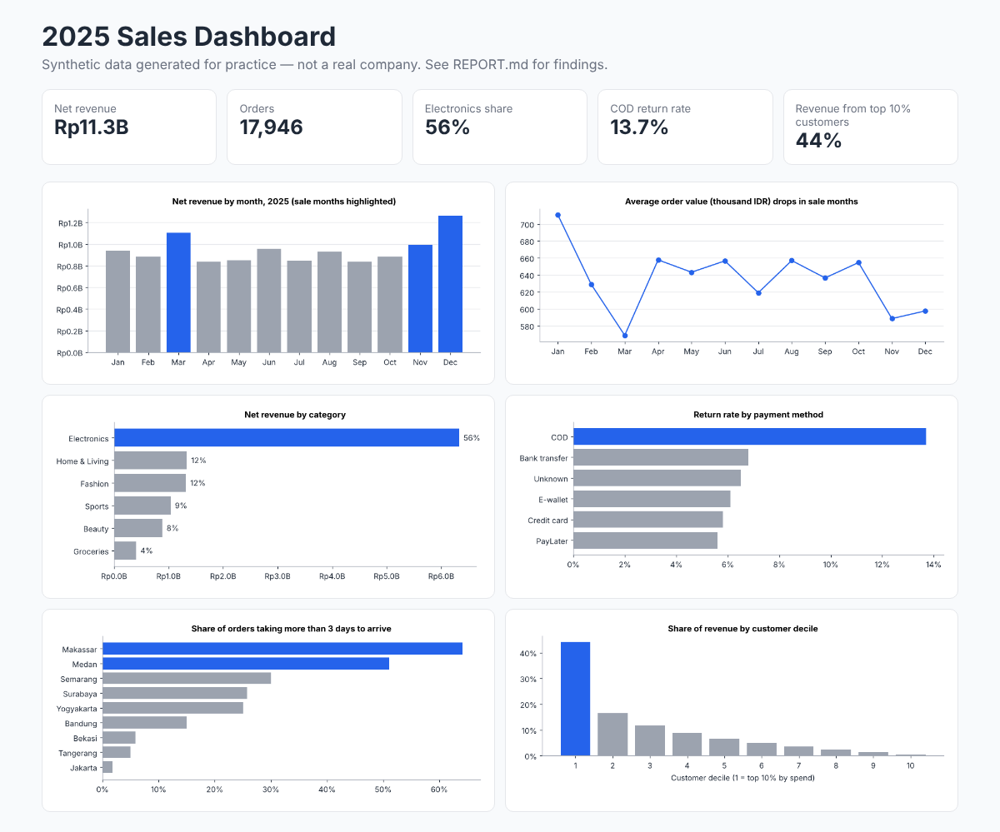

# E-commerce Sales Analysis — SQL, Python & Dashboard

An end-to-end data analysis project: raw CSVs with real-world data problems → cleaning with an audit log → SQLite → business questions answered in SQL → charts, a written report with recommendations, and a dashboard. Automated checks verify the cleaned data and cross-check SQL results against pandas.

> **About the data:** the dataset is **synthetic**, generated by `scripts/generate_data.py` (seeded, so it is the same on every run) for an imaginary Indonesian online store in 2025. It is built to behave like real sales data — seasonal sale months, a few big spenders, more returns on cash-on-delivery, slower delivery outside Java — and includes deliberate quality problems to clean. The findings describe this generated data, not a real company.



## Key findings

1. **Sale months bring more orders, but smaller ones.** March (Ramadan), November (11.11) and December (12.12)
   have 41% more orders than other months, yet the average order value is
   10% lower because of deeper discounts. These 3 months bring 30% of
   revenue, against 25% if sales were spread evenly.
2. **Electronics is 56% of revenue.** The business depends heavily on one category.
   Fashion sells the most lines but has the highest return rate (13.5%).
3. **Cash on delivery is returned about 2.2× as often.** COD's return rate is
   13.7% against 6.2% for the other payment methods, costing
   Rp388 million in returned sales.
4. **Delivery outside Java is slow.** 64% of Makassar orders take more than 3 days
   (average 4.6 days), against 2% in Jakarta.
5. **Revenue is concentrated.** The top 10% of customers bring 44% of revenue, and the top 20%
   bring 61%.

Full write-up: **[reports/REPORT.md](reports/REPORT.md)** · Dashboard: **[reports/dashboard.html](reports/dashboard.html)** (download and open in a browser) · Cleaning log: **[reports/data_quality.md](reports/data_quality.md)**

## Business questions → SQL

| # | Question | Query |
|---|----------|-------|
| 1 | How do revenue, orders and order value move through the year? | [01_monthly_revenue.sql](sql/01_monthly_revenue.sql) |
| 2 | Which categories bring revenue, and which get returned? | [02_category_performance.sql](sql/02_category_performance.sql) |
| 3 | Does payment method affect returns? | [03_payment_returns.sql](sql/03_payment_returns.sql) |
| 4 | Which cities wait longest for delivery? | [04_city_delivery.sql](sql/04_city_delivery.sql) |
| 5 | How concentrated is revenue across customers? | [05_customer_concentration.sql](sql/05_customer_concentration.sql) |
| 6 | How many customers come back? | [06_repeat_customers.sql](sql/06_repeat_customers.sql) |
| 7 | When in the day do people order? | [07_hour_of_day.sql](sql/07_hour_of_day.sql) |

SQL used: CTEs, joins across four tables, conditional aggregation (`CASE WHEN`), window functions (`NTILE`), subqueries.

## Data cleaning

| Problem in the raw data | Fix |
|---|---|
| City typed many ways (`JAKARTA`, ` bandung `, `Jogja`) — 35 spellings | Trim, title case, map nicknames → 9 cities |
| Negative unit prices | Replace with the catalogue price |
| Missing quantities | Drop the line (cannot be inferred) |
| Duplicated order lines | Drop exact duplicates, after fixing prices |
| Orders left with no lines | Remove |
| Missing payment method | Keep the order, label `Unknown` |

Each rule and how many rows it touched is written to [data_quality.md](reports/data_quality.md).

## Run it

```bash
pip install -r requirements.txt
python scripts/generate_data.py   # data/raw/*.csv
python scripts/clean.py           # data/clean/*.csv, data/store.db, reports/data_quality.md
python scripts/analyze.py         # reports/REPORT.md, reports/dashboard.html, reports/figures/
pytest                            # data checks
```

## Structure

```
scripts/   generate_data.py · clean.py · analyze.py
sql/       one file per business question
data/      raw/ (as generated) · clean/ (after cleaning)
reports/   REPORT.md · dashboard.html · data_quality.md · figures/
tests/     checks on the cleaned data and SQL-vs-pandas cross-checks
```

**Tools:** Python (pandas, NumPy, matplotlib), SQL (SQLite), pytest, GitHub Actions.
