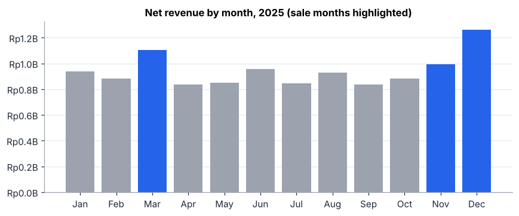
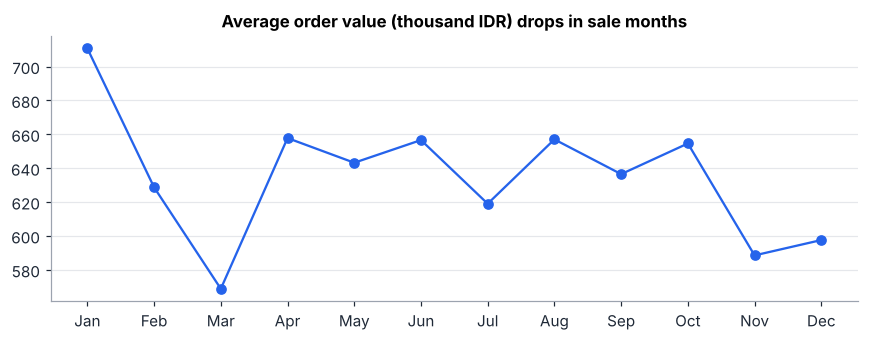
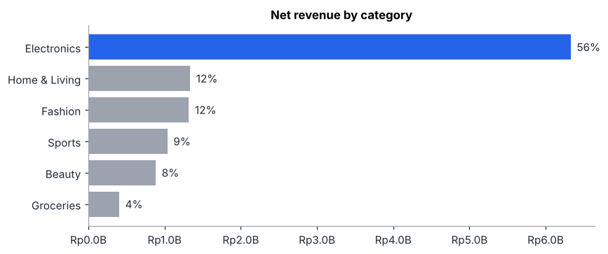
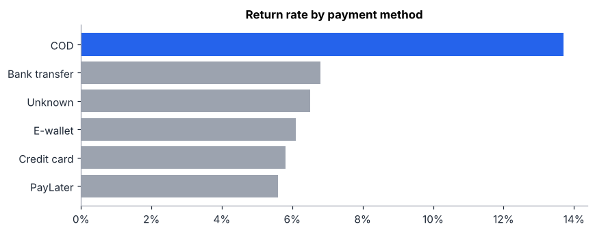
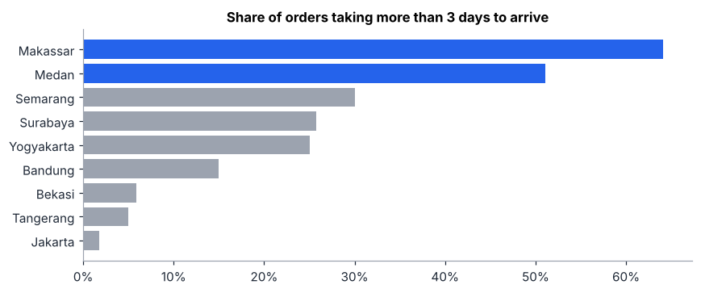
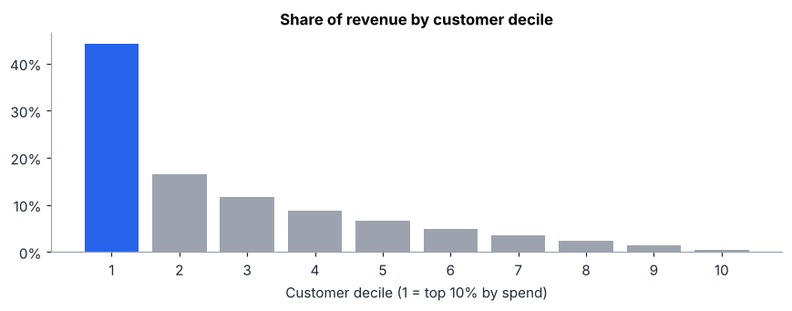

# 2025 Sales Analysis — Online Store (synthetic data)

> **The data is synthetic.** It was generated by `scripts/generate_data.py` to practise a full analysis
> workflow. The numbers describe that generated data, not a real company.

**Scope:** 17,946 orders in 2025, Rp11.31 billion net revenue after discounts and returns.

## Key findings

1. **Sale months bring more orders, but smaller ones.** March (Ramadan), November (11.11) and December (12.12)
   have 41% more orders than other months, yet the average order value is
   10% lower because of deeper discounts. These 3 months bring 30% of
   revenue, against 25% if sales were spread evenly.
2. **Electronics is 56% of revenue.** The business depends heavily on one category.
   Fashion sells the most lines but has the highest return rate (13.5%).
3. **Cash on delivery is returned about 2.2× as often.** COD's return rate is
   13.7% against 6.2% for the other payment methods, costing
   Rp388 million in returned sales.
4. **Delivery outside Java is slow.** 64% of Makassar orders take more than 3 days
   (average 4.6 days), against 2% in Jakarta.
5. **Revenue is concentrated.** The top 10% of customers bring 44% of revenue, and the top 20%
   bring 61%.

## Recommendations

| Finding | Recommendation | How to measure |
|---|---|---|
| Sale months drive revenue but lower order value | Use bundles and free-shipping thresholds in sale months instead of only deeper discounts | Average order value in the next sale month |
| Heavy reliance on one category | Grow Home & Living and Sports with cross-sell placements on Electronics pages | Revenue share of the top category |
| COD returns | Offer a small discount for e-wallet payment and confirm COD orders by WhatsApp before shipping | COD return rate |
| Slow delivery to Medan and Makassar | Test a regional warehouse or a second courier for Sumatra and Sulawesi | Share of orders over 3 days |
| Concentrated revenue | Start a loyalty tier for the top 10% of customers | Repeat orders from the top decile |

## Charts

## Tables

### Category performance
| category      |         revenue |   revenue_share_pct |   avg_discount_pct |   return_rate_pct |   lines |
|:--------------|----------------:|--------------------:|-------------------:|------------------:|--------:|
| Electronics   | 6,328,086,350.0 |                56.0 |               10.0 |               8.6 |    4218 |
| Home & Living | 1,335,732,500.0 |                11.8 |                9.9 |               6.7 |    4701 |
| Fashion       | 1,318,848,050.0 |                11.7 |               10.1 |              13.5 |    7782 |
| Sports        | 1,037,451,800.0 |                 9.2 |                9.9 |               7.0 |    2201 |
| Beauty        |   884,073,600.0 |                 7.8 |                9.9 |               5.3 |    5935 |
| Groceries     |   405,218,400.0 |                 3.6 |               10.1 |               2.2 |    5075 |

### Payment method and returns
| payment_method   |   orders |   return_rate_pct |   revenue_lost |
|:-----------------|---------:|------------------:|---------------:|
| COD              |     3510 |              13.7 |  387,607,550.0 |
| Bank transfer    |     4280 |               6.8 |  230,182,650.0 |
| Unknown          |      107 |               6.5 |    7,305,350.0 |
| E-wallet         |     6847 |               6.1 |  317,276,150.0 |
| Credit card      |     1753 |               5.8 |   68,540,850.0 |
| PayLater         |     1449 |               5.6 |   55,432,700.0 |

### Delivery by city
| city       |   orders |         revenue |   avg_shipping_days |   pct_over_3_days |
|:-----------|---------:|----------------:|--------------------:|------------------:|
| Jakarta    |     5354 | 3,398,019,900.0 |                 1.6 |               1.8 |
| Tangerang  |     2149 | 1,276,462,950.0 |                 1.8 |               5.0 |
| Bekasi     |     1917 | 1,229,672,750.0 |                 1.9 |               5.9 |
| Surabaya   |     1822 | 1,206,775,350.0 |                 2.8 |              25.8 |
| Bandung    |     1931 | 1,113,464,350.0 |                 2.3 |              15.0 |
| Medan      |     1640 | 1,097,230,400.0 |                 3.9 |              51.1 |
| Yogyakarta |     1112 |   686,481,400.0 |                 2.7 |              25.0 |
| Semarang   |     1048 |   663,675,750.0 |                 2.9 |              30.0 |
| Makassar   |      973 |   637,627,850.0 |                 4.6 |              64.1 |

### Repeat customers
| bucket      |   customers |   pct_customers |
|:------------|------------:|----------------:|
| 1 order     |         166 |             6.8 |
| 2-3 orders  |         621 |            25.4 |
| 4-10 orders |        1329 |            54.3 |
| 11+ orders  |         333 |            13.6 |

## Method

1. `generate_data.py` writes four raw CSVs (products, customers, orders, order lines), including duplicates,
   missing values, bad prices and inconsistent city names.
2. `clean.py` fixes those problems, logs each rule in [data_quality.md](data_quality.md), and loads the clean
   tables into SQLite.
3. The questions are answered in SQL (`sql/`); `analyze.py` runs the queries, draws the charts and writes this report.
4. `tests/` checks the cleaned data and that the SQL totals match an independent pandas calculation.
